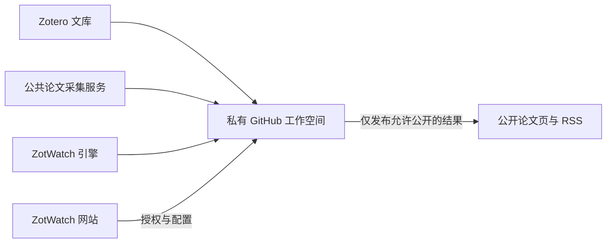

# ZotWatch

**让 Zotero 文库成为你的论文推荐起点。**

ZotWatch 根据你收藏的论文构建个人兴趣中心，持续获取新的学术论文，生成个性化推荐，并通过网页和 RSS 交付。计算在你自己的私有 GitHub 工作空间中运行，公开结果发布到独立仓库。

[开始使用](https://zotwatch.yorks0n.com/) · [English](README.en.md) · [新版开发说明](docs/V2_DEVELOPMENT.md)

## 新版有什么

- **自动兴趣建模**：同步 Zotero 文库，构建每位用户独立的兴趣中心，按版本保存模型并在满足更新条件时重建。
- **每日论文推荐**：从公共候选池召回与兴趣中心相关的论文，结合日期与去重规则生成最多 20 篇推荐。
- **可选 AI**：按需启用标题与摘要翻译，以及 LLM 或 Jev 判断。基础推荐不需要 AI Key；新用户的 AI 功能默认关闭。
- **更具体的判断上下文**：启用判断并允许私人上下文后，生成版本化兴趣画像，为每篇候选检索相近的历史文献。画像保存在私有工作空间中。
- **网页与 RSS**：提供论文阅读页、英文或双语输出；公开发布仅包含允许公开的论文内容，不包含兴趣画像、历史文库和判断理由。
- **独立运行**：网站负责连接账户和管理配置；已经配置好的 GitHub Actions 定时任务不依赖网站持续在线。

## 开始使用

1. 打开 [ZotWatch](https://zotwatch.yorks0n.com/)，使用 GitHub 登录。
2. 按页面引导安装并授权 GitHub 应用，创建个人工作空间。
3. 连接 Zotero，授权读取自己的文库。
4. 等待首次同步、兴趣模型构建和推荐运行完成。首次运行通常比后续增量运行更久。
5. 在页面查看运行状态和结果入口，将生成的 RSS 地址加入 Zotero 或其他 RSS 阅读器。

初始化会使用**私有运行仓库 + 独立公开结果仓库**。前者保存配置和私人计算状态，后者承载论文页面与 RSS。无需 Fork 本引擎仓库，也不需要自行部署公共采集服务。

可在网站配置每日运行时间及可选 AI 连接。翻译和判断可以分别启用；使用 Jev 判断时，兴趣画像生成仍需要可用的 LLM 连接。请以自己的工作空间返回的结果地址为准，不要订阅开发者的测试 feed。

## 推荐与 AI 的边界

基础推荐使用文库语义与兴趣中心，AI 发布处理在原推荐列表之后执行。判断失败时保留原列表，翻译失败时保留英文，不把服务失败当成论文质量结论。

文库有效论文过少、无法形成合格兴趣中心、候选不足或数据源异常，都可能导致未就绪、少量推荐或空结果。系统不会为了凑齐数量而静默降低模型要求。摘要层面的 AI 判断也不能替代阅读全文。

启用带私人上下文的 AI 功能后，所选服务会收到受限的历史论文片段或兴趣描述；这些内容不写入公开 RSS。详细行为见 [兴趣中心画像](docs/CENTER_PORTRAITS_V1.md) 和 [可选 AI 使用说明](docs/P5C9_LOCAL_USAGE.md)。

## 项目组成

| 组件 | 职责 |
| --- | --- |
| [ZotWatch](https://github.com/Yorks0n/ZotWatch)（本仓库） | Python 引擎、模型生命周期、配置契约、共享 Actions 工作流、RSS 发布工具 |
| [zotwatch-web](https://github.com/Yorks0n/zotwatch-web) | Web 前端和 Cloudflare Worker，处理授权、初始化、配置及运行管理（私有源码） |
| [zotwatch-workspace-template](https://github.com/Yorks0n/zotwatch-workspace-template) | 版本化个人工作空间模板（私有源码） |
| [zotwatch-public-harvester](https://github.com/Yorks0n/zotwatch-public-harvester) | 公共论文元数据采集、去重、存储和读取 API |
| 用户的私有工作空间 | 配置、凭据、定时执行与私人模型状态 |
| 用户的公开结果仓库 | 论文阅读页和 RSS |



## 本地开发

要求 Python 3.11+。在源码目录创建环境并安装；这里的命令从当前 checkout 安装，不代表已有 PyPI 稳定版：

```sh
git clone https://github.com/Yorks0n/ZotWatch.git
cd ZotWatch
python3.11 -m venv .venv
source .venv/bin/activate
python -m pip install -e '.[latent]'
zotwatch --help
```

个人配置、凭据和计算状态应放在独立工作空间。对于已有 `zotwatch.yaml` 的工作空间，可以先做离线配置验证：

```sh
zotwatch config validate --workspace /path/to/private-workspace
```

配置验证通过不等于凭据、模型缓存和远端服务已就绪。新版自动推荐需要私有仓库身份及固定编码器等运行条件，建议通过网站初始化的工作流运行，不要把旧版 `watch --rss` 命令直接套到 `latent-auto-v1` 配置上。

本地可选 AI 工具与示例见 [使用说明](docs/P5C9_LOCAL_USAGE.md)、[默认关闭的 AI 配置](examples/optional-llm.yaml)。旧版 Fork、三 YAML 配置和本地 `src.cli` 路径见 [历史使用说明](docs/legacy-usage.zh-CN.md)。

### 测试与构建

```sh
python -m pip install -r tests/requirements-latent.txt -r tests/packaging-requirements.txt
HF_HUB_OFFLINE=1 TRANSFORMERS_OFFLINE=1 python -m pytest -c tests/pytest.ini -q
python -m build --no-isolation
```

离线测试使用合成数据；安装隔离测试需专门的 wheel/editable 环境，由 packaging CI 执行。构建和本地测试不调用真实用户文库，也不代表线上端到端验收。

## 版本与升级

本分支汇总 ZotWatch 2.x 开发成果，Python 包版本仍为 `2.0.0.dev1`。新版网站已有部署记录；源码整理不等于发布新的稳定版本，也不会自动升级现有用户。

个人工作流固定引用完整引擎提交 SHA，Web 的支持版本、初始化模板及发布脚本需要配套升级。开发阶段的 `P5C*` 文档和包含 `staging` 的工作流名称保留用于版本追溯，不代表所有这些文件都是独立产品入口。提交、验证和发布边界见 [新版开发说明](docs/V2_DEVELOPMENT.md)。

## 目录

```text
zotwatch/           CLI、配置、运行契约、兴趣模型、可选 AI
src/                同步、向量化、候选、评分及旧版兼容模块
scripts/            RSS 发布、诊断与开发工具
.github/workflows/  可复用运行工作流及 CI
examples/           带版本语义的调用与配置示例
tests/              离线回归、契约、安装和工作流测试
docs/               架构契约、功能说明和历史验收记录
```

## 许可证

[MIT](LICENSE)
